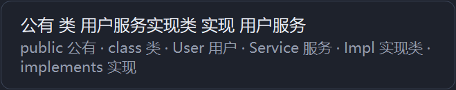
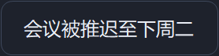
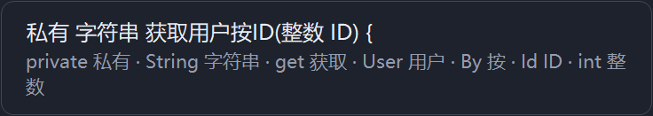

# TranslatePop · 划屏翻译

选中任意窗口里的英文单词或代码，按一下热键，鼠标旁边立刻弹出中文译文。

为「读英文时遇到不认识的词」这个场景做的：不切窗口、不复制粘贴、不离开当前行。



## 特点

- **全局热键，任何程序都能用** — IDEA、VS Code、Chrome / Edge、PDF 阅读器、终端，只要能用鼠标选中文字就行。
- **卡片贴在鼠标旁边** — 每次触发都重新定位到当前光标，不会停在上一次的位置。
- **卡片不抢焦点** — 不激活、不打断输入；鼠标移上去自动暂停消失倒计时。
- **调本地 Mtranserver** — 内网 / 离线可用，译文不出本机；单次往返约 0.2 秒。
- **代码模式** — 选中 `UserServiceImpl` / `getUserById` / `SNAKE_CASE` 这类标识符时，自动拆词并给出「整句译文 + 逐词对照」两行。
- **单文件、无依赖** — 一个 C# 源文件，用系统自带的 `csc.exe` 就能编译；不需要 .NET SDK，不需要第三方库。

## 快速开始

### 1. 准备本地翻译服务

本项目**只负责取词和弹窗**，翻译交给 [MTranServer](https://github.com/xxnuo/MTranServer)（本地离线翻译服务，默认端口 8989）。先把它跑起来：

```bash
curl http://localhost:8989/health
# {"status":"ok"} 就绪
```

### 2. 拿到 TranslatePop

- **直接用**：到 [Releases](../../releases) 下载 `TranslatePop.exe`（单文件，无需安装），放到任意目录（例如 `D:\Tools\TranslatePop\`）。
- **自己编译**：见下面的[构建](#构建)。

### 3. 运行

1. 双击 `TranslatePop.exe`。
   - 第一次会弹一次 UAC，点「是」（原因见[为什么需要管理员权限](#为什么需要管理员权限)）。
   - 想以后都不弹：托盘菜单 →「启用静默提权」，之后双击即静默管理员启动。
2. 右下角出现托盘图标，提示文字会显示当前生效的热键。
3. 在任意窗口选中英文，按 **Alt + `**（反引号，Esc 下面那个键）。
4. 卡片先显示「翻译中…」，约 0.3 秒后原地换成译文。



卡片操作：

| 操作 | 效果 |
|---|---|
| 鼠标移上去 | 暂停自动消失（默认 8 秒后关） |
| 左键点卡片 | 复制译文到剪贴板，0.7 秒后关 |
| 右键点卡片 | 立刻关闭 |

## 代码模式

选中代码标识符或整行代码，卡片自动变成两行：

```
公有 类 用户服务实现类 实现 用户服务
public 公有 · class 类 · User 用户 · Service 服务 · Impl 实现类 · implements 实现
```

上行是整句译文，下行是逐词对照（小一号、灰色）。带括号的语句同样保留结构：



**什么时候进代码模式**：选中内容含 `( ) { } = ; _ < >` 等强代码标点，或没有空格但带 camelCase / 全大写 / 点斜杠井号，或英文句子里夹着 `UserService`、`user_id` 这类标识符。普通英文句子仍然是单行。

**为什么要拆词**：`/translate` 对没加空格的标识符基本无效 —— 实测 `getUserById` 会被原样吐回 `getUserByid`，`SNAKE_CASE_CONST` 干脆不动。所以先按 IDEA 的拆词规则切分：

```
(?<=[a-z])(?=[A-Z])        get|User|By|Id       驼峰转折处
(?<=[A-Z])(?=[A-Z][a-z])   HTTP|Response        连续大写后接小写
[^A-Za-z0-9]+              任意非字母数字        下划线、点、括号、减号
```

**怎么挑译文**：拆完之后走三条路，取「英文残留最少、且原代码结构保留最多」的那条：

1. 原文直译，再把译文里残留的标识符整体换成中文（保留括号分号的结构）；
2. 句子里的驼峰标识符先摊开再整句译（`public class UserServiceImpl implements UserService` → 公共类 用户服务 实现类 实现 用户服务）；
3. 按内置术语表逐词替换，原标点原样不动。

打分时数原文里的代码标点（括号、点、等号、分号），译文保留得越多越优先 —— 所以带 `(id) { }` 的语句不会被意译版挤掉。

**本地术语表**：约 500 条常用词（`get` / `user` / `thread` / `handler` …），词表命中的词直接本地出结果、不调接口；复数会自动降级（`handles` → 处理）。词表还专门纠正了 Mtranserver 的几处误译：

| 词 | Mtranserver 直译 | 词表 |
|---|---|---|
| `regex` | 雷格克斯 | 正则 |
| `case` | 案例 | 分支 |
| `executor` | 执行人 | 执行器 |
| `snake` | 蛇 | 蛇形命名 |

自定义：编辑配置目录下的 `glossary.txt`（首次运行自动生成模板），每行 `word=中文`，同名覆盖内置。

关掉代码模式：`config.ini` 里 `codemode=0`。

## 为什么需要管理员权限

取词的实现是「模拟 Ctrl+C + 读剪贴板」。Windows 的 **UIPI**（User Interface Privilege Isolation）会**静默丢弃**低权限进程发给高权限窗口的模拟按键。

问题在于你往往不知道目标程序是怎么被启动的 —— JetBrains Toolbox、安装器、某个更新器都可能留下一个高完整性级别的进程，即使属性里没勾「以管理员身份运行」。这时的表现是：热键有反应、卡片弹出「没有取到选中文本」，但剪贴板里空空如也。

**解法**：翻译工具自身以管理员身份运行，就能跨过这道墙。所以 `config.ini` 里默认 `elevate=auto`：

| `elevate` | 行为 |
|---|---|
| `auto`（默认） | 优先用「静默提权」计划任务重启自己（不弹 UAC）；任务不存在时退回 `runas`（弹一次 UAC） |
| `on` | 每次都走 `runas`，每次弹 UAC |
| `off` | 不申请管理员权限（能翻普通程序，翻不了管理员程序） |

程序 manifest 是 `asInvoker`（不是 `requireAdministrator`），提权由程序自己在启动时完成 —— 这样才有「不弹 UAC」的余地。

### 免 UAC 自启

托盘菜单 →「开机自启」会创建一个计划任务 `TranslatePopElevated`（登录触发、`/RL HIGHEST`），开机后自动以管理员身份静默启动。取消勾选即删除。

> 计划任务还没建好的第一次启动仍会弹一次 UAC。也可以直接点托盘里的「启用静默提权」先把任务建好（`install.cmd` 会自动做这件事）。

## 热键

默认 **Alt + `**（反引号，Esc 下面那个键）。注册失败会自动回落到 **Ctrl + Alt + `**，托盘提示与日志里都会写明。

改热键：编辑 `config.ini` 的 `hotkey=`，重启生效。支持 `win` / `ctrl` / `alt` / `shift` 组合加字母、数字、`f1-f12`、反引号、撇号、减号等，例如 `ctrl+alt+t`、`alt+z`。

**避坑**：Win + ` 在很多机器上不可靠 —— Windows Terminal 的 quake 模式、Razer Synapse 等外设驱动会在系统分发阶段抢先消费这个组合，`RegisterHotKey` 明明返回成功却永远收不到 `WM_HOTKEY`。程序为此额外装了一个 `WH_KEYBOARD_LL` 底层键盘钩子作为主触发路径（命中即吞掉按键），但系统级抢占仍可能发生。**默认用 Alt + ` 就是为了绕开这些抢占。**

## 配置

配置文件按顺序找第一个可写的位置：`%APPDATA%\TranslatePop\config.ini` → `<exe 同目录>\data\config.ini` → `%TEMP%\TranslatePop\config.ini`。托盘菜单「打开配置」直接定位到实际生效的那一份。

| 键 | 说明 | 默认 |
|---|---|---|
| `endpoint` | Mtranserver 地址 | `http://localhost:8989` |
| `from` / `to` | 语言方向 | `en` → `zh` |
| `hotkey` | 首选热键 | alt + 反引号 |
| `fallbackhotkey` | 首选注册失败时的备选 | ctrl + alt + 反引号 |
| `autohidems` | 卡片自动消失毫秒数（0 = 不消失） | `8000` |
| `maxwidth` | 卡片最大宽度（96 DPI 下像素） | `460` |
| `fontsizepx` | 字号（96 DPI） | `16` |
| `maxchars` | 取词上限，超出截断 | `3000` |
| `codemode` | 代码模式（逐词对照行） | `1` |
| `elevate` | 提权策略：`auto` / `on` / `off` | `auto` |

## 工作原理

```
按下 Alt + `
  → 卡片立刻跳到当前鼠标位置（此时还没开始取词）
  → 等修饰键松开（避免 Alt 还按着干扰 Ctrl+C）
  → 备份剪贴板里的文本类格式（UnicodeText/Text/HTML/RTF）
  → 依次尝试 4 种发键方式，命中即停：
        1) keybd_event Ctrl+C      ← 实测 IDEA 里第一个可用
        2) SendInput 扫描码 Ctrl+C
        3) Ctrl+Insert
        4) Shift+Ctrl+C 再 Ctrl+C
  → 轮询剪贴板序列号（20ms 间隔，首个等 500ms）
  → 立刻弹「翻译中…」，后台线程还原剪贴板
  → POST /translate（代码模式走 /translate/batch，一次拿整句 + 逐词）
  → 卡片原地换成译文
```

典型耗时：热键 → 出译文约 0.4–0.6 秒（取词 ~0.2–0.5 秒 + 翻译 ~0.2 秒）。Mtranserver 冷启动首帧要 2 秒左右，程序启动时会在后台预热一次。

## 自检命令

```cmd
TranslatePop.exe --check                        # 检查服务连通与翻译
TranslatePop.exe --text "serendipity"           # 直接翻一段文字
TranslatePop.exe --grab                         # 打印当前选区取词结果
TranslatePop.exe --hotkeytest                   # 检查热键能否注册
TranslatePop.exe --hooktest --seconds 5 --self  # 检查底层键盘钩子
TranslatePop.exe --code                         # 代码模式批量自检
TranslatePop.exe --code --text getUserById      # 只测一个标识符
TranslatePop.exe --mix --text "getUserById"     # 打印拆词与逐词替换过程
TranslatePop.exe --render --png card.png        # 渲染卡片预览图
TranslatePop.exe --install-task                 # 建「静默提权」计划任务
TranslatePop.exe --uninstall-task               # 删掉它
```

日志在配置目录下的 `log.txt`，每次翻译会记 `t0 hotkey->work` / `t1 mods released` / `t2 grabbed` / `t3 translated` / `t4 card shown` 五段耗时。

## 构建

只需要 Windows 自带的 .NET Framework 4.x 编译器，不需要安装 .NET SDK 或 Visual Studio：

```cmd
build.cmd      :: 编译正式版 → dist\TranslatePop.exe
build2.cmd     :: 编译开发版 → dist\TranslatePopDev.exe（不提权，用来复现 UIPI 取不到词的现象）
install.cmd    :: 部署：结束旧实例、换新版、补配置、建静默提权计划任务（需管理员，会弹一次 UAC）
```

说明：`build.cmd` 先编到项目根目录再搬进 `dist\`，因为被低完整性标签标记过的 `dist` 目录可能不允许低权限进程直接写入。

## 文件

| 路径 | 说明 |
|---|---|
| `src\TranslatePop.cs` | 全部源码（单文件，C# 5 语法，供 `csc.exe` 编译） |
| `src\app.manifest` | 正式版清单（`asInvoker` + PerMonitorV2 DPI，提权由程序自己完成） |
| `src\app.dev.manifest` | 开发版清单 |
| `build.cmd` | 编译正式版 |
| `build2.cmd` | 编译开发版（不提权，用于复现 UIPI） |
| `install.cmd` | 部署 + 建静默提权计划任务 |
| `deploy.cmd` | `install.cmd` 的快捷入口 |
| `docs\` | README 用的卡片截图 |
| `tools\TestKit.cs` | 调试辅助：造置顶窗口、模拟热键、截图、枚举窗口 |
| `tools\sample.html`、`web-test.html` | 浏览器选词测试页 |

运行时生成（不入库）：配置 `config.ini`、日志 `log.txt`、自定义词表 `glossary.txt`，都在配置目录里。

## 已知限制

- **只能 Windows**：Win32 API（剪贴板序列号、`WH_KEYBOARD_LL` 钩子、`WS_EX_NOACTIVATE` 窗口）没有跨平台封装。
- **依赖剪贴板取词**：会临时占用剪贴板，取完立刻还原（只备份文本类格式，图片/文件流不备份）。如果目标程序屏蔽了 Ctrl+C，取词就会失败。
- **必须管理员权限**才能翻译以管理员身份运行的程序（UIPI 的硬限制，无法绕过）。
- **语言方向固定**为配置里的 `from` → `to`，目前没有做自动语种检测。
- **只显示译文**：没有发音、生词本、整页翻译。
- 卡片是普通 Win32 置顶窗口，**不会**出现在全屏独占游戏或某些独占全屏应用的画面上。

## 致谢

- [MTranServer](https://github.com/xxnuo/MTranServer) — 本地离线翻译服务（BSD 2-Clause），去掉了云端依赖，也是这个项目能「秒回」的前提。
- [billion-context](https://github.com/ranxianglei/billion-context) — 开发过程中用到的上下文管理工具。

## License

[MIT](LICENSE) © 2026 junjyyy
